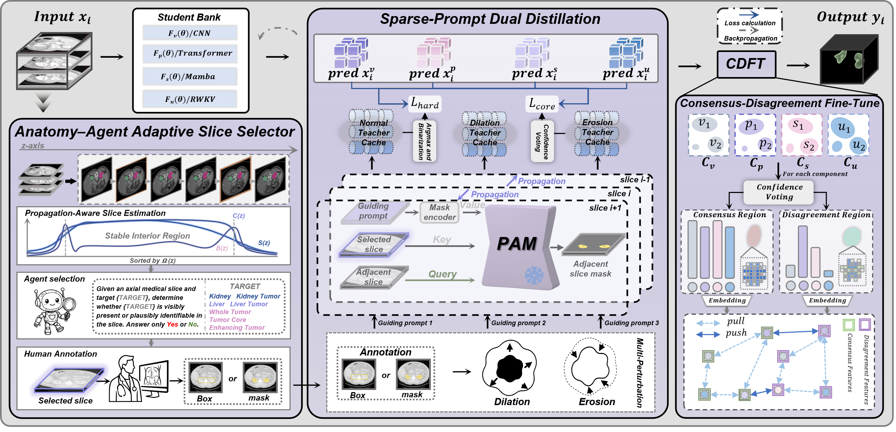

# DisPAM

Official implementation of **From One Slice to the Whole Volume: Single-Slice Supervision for Weakly Supervised 3D Medical Image Segmentation**.

DisPAM learns target-specific 3D segmentation models from one selected
single-slice mask. It combines Anatomy-Agent Adaptive Slice Selector,
Sparse-Prompt Dual Distillation, and Consensus-Divergence Fine-Tune (CDFT).
The trained model bank performs Prompt-Free segmentation at test time.



## Environment

The reported experiments used Python 3.10.20, PyTorch 2.1.0, CUDA 12.1, and
MONAI 1.3.0. Create the environment with:

```bash
conda env create -f environment.yml
conda activate dispam
```

The experiments were run on NVIDIA A40 GPUs. Other CUDA devices can be used
when they provide sufficient memory for a `96 x 96 x 96` training crop.

## Data

The experiments use the public KiTS19, BraTS18, and LiTS datasets. Download
each dataset from its official source and organize it as follows:

```text
KiTS19/
  case_00000/imaging.nii.gz
  case_00000/segmentation.nii.gz

BraTS18/
  HGG/<case_id>/<case_id>_flair.nii.gz
  HGG/<case_id>/<case_id>_seg.nii.gz

LiTS/
  ct/volume-0.nii
  seg/segmentation-0.nii
```

The released split files are in `configs/splits/`. Validate the data before
training:

```bash
python scripts/prepare_dataset.py \
  --dataset kits19 \
  --dataset-root /path/to/KiTS19 \
  --split-file configs/splits/kits19.json \
  --splits train val \
  --check-volumes \
  --output outputs/manifests/kits19.json
```

The target names are `kidney` and `tumor` for KiTS19, `wt`, `tc`, and `et` for
BraTS18, and `liver` and `tumor` for LiTS. Each target is trained independently.

## PAM Weights

Place the frozen PAM checkpoints under:

```text
checkpoints/pam/propmask.pth
checkpoints/pam/box2mask.pth
```

`propmask.pth` is used by the main single-slice mask setting. `box2mask.pth` is
only required for the 2D box extension. The checkpoints used in the paper have
the following SHA-256 checksums:

```text
propmask.pth  97285dc96855f2842b1fcda91b9024ce400a3894476b692f93918beabf0efb83
box2mask.pth  bb0eb0da5669390b2baa196809915fd00222be9bdf4d8de5045206809b56d3fe
```

## Training

The commands below show one KiTS19 kidney run. Replace the dataset, target, and
paths for the other experiments.

```bash
DATASET=kits19
DATA_ROOT=/path/to/KiTS19
SPLIT=configs/splits/kits19.json
TARGET=kidney
SEED=0
```

### 1. PAM Cache

PASE ranks candidate slices, and the VLM Agent evaluates target visibility in
descending score order. The released format records the three Yes/No decisions
for each queried slice. Examples are provided in `examples/`.

```bash
python scripts/build_pam_cache.py \
  --dataset "$DATASET" \
  --dataset-root "$DATA_ROOT" \
  --split-file "$SPLIT" \
  --targets "$TARGET" \
  --cache-root outputs/pam_cache \
  --pam-checkpoint checkpoints/pam/propmask.pth \
  --prompt-type mask \
  --prompt-file configs/vlm_prompts.json \
  --agent-backend replay \
  --agent-decisions /path/to/agent_decisions.json \
  --clinician-fallback /path/to/clinician_fallback.json \
  --device cuda:0 \
  --seed "$SEED"
```

An OpenAI-compatible VLM endpoint can be used with `--agent-backend api`,
`--agent-model`, and `--agent-endpoint`. The decoding temperature is fixed to
zero.

### 2. Sparse-Prompt Dual Distillation

Train VISTA3D, PrimusV2, SegMambaV2, and U-RWKV from the same target-specific
PAM Cache:

```bash
for MODEL in vista3d primusv2 segmambav2 urwkv; do
  python scripts/train_dual_distillation.py \
    --dataset "$DATASET" \
    --dataset-root "$DATA_ROOT" \
    --split-file "$SPLIT" \
    --cache-root outputs/pam_cache \
    --target "$TARGET" \
    --model "$MODEL" \
    --output-dir "outputs/dual/$TARGET/$MODEL/seed_$SEED" \
    --epochs 100 \
    --device cuda:0 \
    --amp \
    --seed "$SEED"
done
```

### 3. Consensus-Divergence Fine-Tune

Construct fixed Consensus and Divergence regions from the four
dual-distilled models:

```bash
python scripts/build_cdft_regions.py \
  --dataset "$DATASET" \
  --dataset-root "$DATA_ROOT" \
  --split-file "$SPLIT" \
  --target "$TARGET" \
  --checkpoint vista3d="outputs/dual/$TARGET/vista3d/seed_$SEED/best.pt" \
  --checkpoint primusv2="outputs/dual/$TARGET/primusv2/seed_$SEED/best.pt" \
  --checkpoint segmambav2="outputs/dual/$TARGET/segmambav2/seed_$SEED/best.pt" \
  --checkpoint urwkv="outputs/dual/$TARGET/urwkv/seed_$SEED/best.pt" \
  --output-root "outputs/cdft_regions/seed_$SEED" \
  --device cuda:0 \
  --amp \
  --seed "$SEED"
```

Jointly fine-tune the four students for 10 epochs:

```bash
python scripts/train_cdft.py \
  --dataset "$DATASET" \
  --dataset-root "$DATA_ROOT" \
  --split-file "$SPLIT" \
  --cache-root outputs/pam_cache \
  --region-root "outputs/cdft_regions/seed_$SEED" \
  --target "$TARGET" \
  --checkpoint vista3d="outputs/dual/$TARGET/vista3d/seed_$SEED/best.pt" \
  --checkpoint primusv2="outputs/dual/$TARGET/primusv2/seed_$SEED/best.pt" \
  --checkpoint segmambav2="outputs/dual/$TARGET/segmambav2/seed_$SEED/best.pt" \
  --checkpoint urwkv="outputs/dual/$TARGET/urwkv/seed_$SEED/best.pt" \
  --output-dir "outputs/cdft/$TARGET/seed_$SEED" \
  --epochs 10 \
  --device cuda:0 \
  --amp \
  --seed "$SEED"
```

## Prompt-Free Testing

Supply the four CDFT checkpoints for each target:

```bash
python scripts/evaluate.py \
  --dataset "$DATASET" \
  --dataset-root "$DATA_ROOT" \
  --split-file "$SPLIT" \
  --split val \
  --bank "$TARGET:vista3d=outputs/cdft/$TARGET/seed_$SEED/best/vista3d.pt" \
  --bank "$TARGET:primusv2=outputs/cdft/$TARGET/seed_$SEED/best/primusv2.pt" \
  --bank "$TARGET:segmambav2=outputs/cdft/$TARGET/seed_$SEED/best/segmambav2.pt" \
  --bank "$TARGET:urwkv=outputs/cdft/$TARGET/seed_$SEED/best/urwkv.pt" \
  --output-dir "outputs/evaluation/$DATASET/seed_$SEED" \
  --device cuda:0 \
  --amp \
  --seed "$SEED"
```

Testing averages the four full-volume probability maps and requires no PAM
input or clinical prompt.

## Reproducibility

All reported configurations use five independent runs with seeds `0`--`4`.
Metrics are first averaged across the five runs for each case. The reported
mean and population standard deviation are then computed across the case-level
averages.

```bash
python scripts/aggregate_runs.py \
  --run outputs/evaluation/kits19/seed_0/kidney_cases.csv \
  --run outputs/evaluation/kits19/seed_1/kidney_cases.csv \
  --run outputs/evaluation/kits19/seed_2/kidney_cases.csv \
  --run outputs/evaluation/kits19/seed_3/kidney_cases.csv \
  --run outputs/evaluation/kits19/seed_4/kidney_cases.csv \
  --output-dir outputs/evaluation/kits19/aggregate/kidney
```

Final settings are listed in `configs/hyperparameters.json`. Their sources are
summarized in `docs/HYPERPARAMETER_PROVENANCE.md`. No hyperparameter sweep was
performed.

## Code Structure

| Path | Paper component |
| --- | --- |
| `dispam/slice_selector.py` | Propagation-Aware Slice Estimation |
| `dispam/agent.py` | Agent Selection |
| `dispam/pam.py` | Multi-Perturbation PAM Propagation |
| `dispam/losses.py` | Hard-Core Dual Distillation and CDFT objectives |
| `dispam/components.py` | Consensus-Divergence Zone Determination |
| `dispam/models/` | VISTA3D, PrimusV2, SegMambaV2, and U-RWKV |
| `scripts/train_dual_distillation.py` | Sparse-Prompt Dual Distillation |
| `scripts/train_cdft.py` | Consensus-Divergence Fine-Tune |
| `scripts/evaluate.py` | Prompt-Free testing |

Run the core checks with:

```bash
python -m unittest -v tests.test_components
```

## Acknowledgements

This repository includes or adapts research code from PAM, MONAI/VISTA3D,
Primus, SegMamba, U-RWKV, timm, and dynamic-network-architectures. See
`THIRD_PARTY_NOTICES.md` for details.

## License

The DisPAM integration code is released under the Apache-2.0 License. Dataset,
checkpoint, and third-party code terms remain governed by their original
providers.
