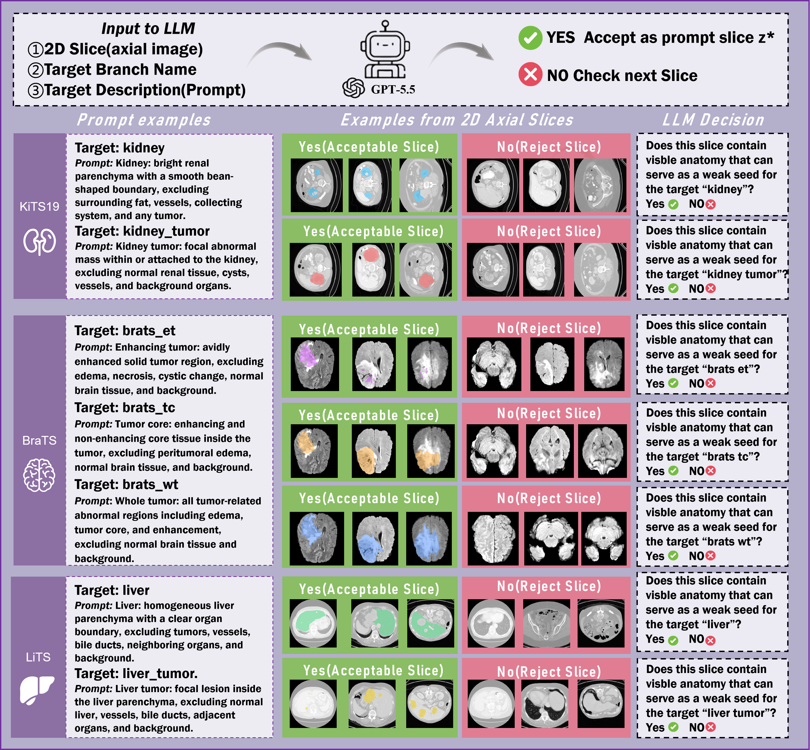
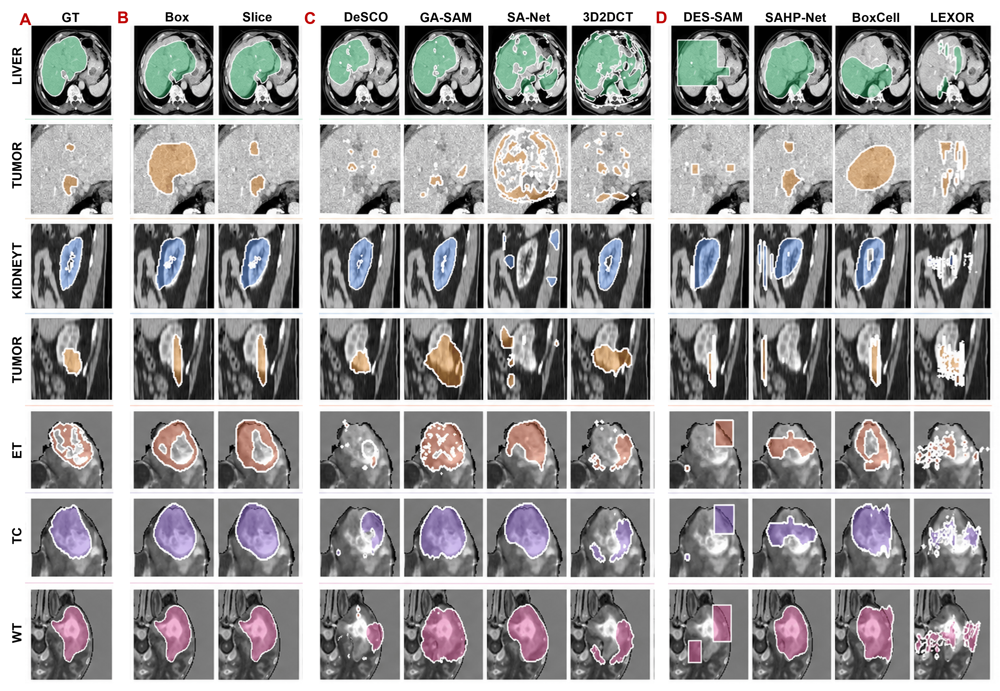

<div align="center">

# DisPAM

### From One Slice to the Whole Volume
**Single-Slice Supervision for Weakly Supervised 3D Medical Image Segmentation**

<em>从单张切片到完整体积：弱监督三维医学图像分割</em>

<br><br>


[](LICENSE)

[Overview](#overview) · [Framework](#framework) · [Quick Start](#quick-start) · [Datasets](#datasets) · [Results](#results)

[Repository](https://github.com/wenjing-gg/DisPAM) · [Setup & Usage](docs/USAGE.md)

</div>

---

<a id="overview"></a>
## 📌 Overview

**DisPAM** learns 3D medical image segmentation from **one annotated axial slice per present target**. It combines anatomy-aware slice selection, frozen PAM teacher propagation, and heterogeneous student refinement. The trained students predict volumetric masks **without case-specific prompts at inference**.

| Annotation | Datasets | Targets | Inference |
| :---: | :---: | :---: | :---: |
| **1 slice / present target** | **3** | **7** | **Prompt-free** |

> “One slice” is target-specific, not necessarily one slice for an entire multi-target volume. In the manuscript experiments, prompts are simulated from the selected reference-label slice.

---

<a id="framework"></a>
## 🏗️ Framework

<p align="center">
  
</p>
<p align="center"><em>Slice selection, sparse-prompt distillation, and student refinement.</em></p>

| Stage | Method | Output |
| :--- | :--- | :--- |
| **1 · Select** | PASE ranks candidate slices; a vision-language agent checks target visibility. | One guiding slice with a box or mask per present target. |
| **2 · Distill** | Frozen PAM propagates Normal, Dilation, and Erosion prompts; HCDD combines Hard and Core supervision. | Four independently trained students. |
| **3 · Refine** | CDFT uses cross-model agreement and disagreement for segmentation and component-level contrastive refinement. | A refined student bank for prompt-free prediction. |

The student bank comprises **VISTA3D (CNN)**, **PrimusV2 (Transformer)**, **SegMambaV2 (Mamba)**, and **U-RWKV (RWKV)**. Final predictions average their refined probability maps for each target.

### Anatomy-Agent Slice Selection

PASE scores slices using anatomical support, axial interior position, and local stability. The vision-language agent screens candidate slices for target visibility.

<p align="center">
  
</p>

---

<a id="quick-start"></a>
## 🔧 Quick Start

```bash
git clone https://github.com/wenjing-gg/DisPAM.git
cd DisPAM

conda env create -f environment.yml
conda activate dispam
```

1. Prepare the datasets, fixed splits, and pretrained PAM weights.
2. Select target-specific guiding slices and build the three teacher caches.
3. Train the four students with HCDD, then refine them with CDFT.
4. Run prediction and evaluation using the trained student bank.

See **[Setup & Usage](docs/USAGE.md)** for data preparation, script arguments, and checkpoint paths.

---

<a id="datasets"></a>
## 📦 Datasets

| Dataset | Modality | Train | Validation | Test | Targets |
| :--- | :---: | ---: | ---: | ---: | :--- |
| **KiTS19** | CT | 161 | 18 | 20 | Kidney, kidney tumor |
| **BraTS18** | MRI | 205 | 23 | 57 | Whole tumor (WT), tumor core (TC), enhancing tumor (ET) |
| **LiTS** | CT | 94 | 10 | 27 | Liver, liver tumor |

Use the fixed **[split files](configs/splits/)** for all experiments. Training uses `train`, checkpoint selection uses `val`, and final reporting uses `test`. Absent targets receive no prompt or teacher cache.

---

<a id="results"></a>
## 📊 Results

### Quantitative Results

**DisPAM-slice** results from manuscript Tables I–III. Values are means; ↑ indicates higher is better, and ↓ indicates lower is better.

| Dataset | Target | DSC ↑ | IoU ↑ | HD95 ↓ | ASSD ↓ |
| :--- | :--- | ---: | ---: | ---: | ---: |
| **KiTS19** | Kidney | 0.8690 | 0.7780 | 23.70 | 6.31 |
| **KiTS19** | Tumor | 0.8712 | 0.7913 | 4.81 | 1.23 |
| **BraTS18** | WT | 0.8922 | 0.8143 | 6.22 | 1.77 |
| **BraTS18** | TC | 0.8180 | 0.7078 | 7.43 | 2.01 |
| **BraTS18** | ET | 0.7073 | 0.5751 | 7.24 | 1.93 |
| **LiTS** | Liver | 0.9466 | 0.8997 | 7.50 | 1.86 |
| **LiTS** | Tumor | 0.7321 | 0.5957 | 64.20 | 14.23 |

> These paper-reported values use the manuscript's two-way train/evaluation split; they are not results from the three-way split listed above.

### Qualitative Results

<p align="center">
  
</p>

[View full-resolution image](assets/visualization1.png)

---

## 🤝 Acknowledgements & License

DisPAM builds on **PAM, MONAI/VISTA3D, Primus, SegMamba, U-RWKV, timm**, and **dynamic-network-architectures**. See [Third-Party Notices](THIRD_PARTY_NOTICES.md).

Released under the **[Apache-2.0 License](LICENSE)**.
